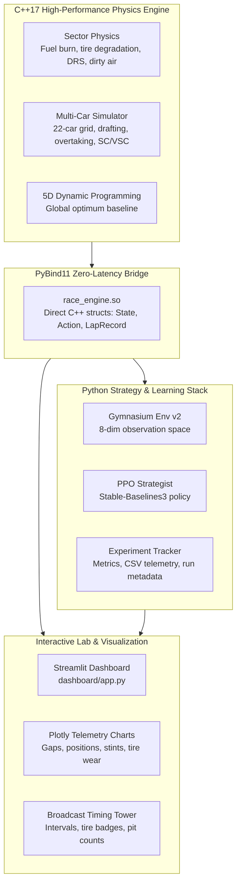

# F1 Multi-Agent AI Strategy Engine & Interactive Lab

This project is a hybrid race-strategy system that combines a high-frequency C++17 simulation backend with Python-based reinforcement learning, dynamic programming optimization, and an interactive Streamlit & Plotly strategy dashboard. The goal is to build an end-to-end race strategy engine that models tire wear, fuel burn, traffic interactions, dirty air, DRS slipstreaming, and Safety Car / VSC disruption with mathematical rigor and real-time visualization.

---

## Interactive F1 Race Strategy Lab

The project features a full **Interactive F1 Race Strategy Lab** built with Streamlit and Plotly, styled with an authentic F1 broadcast dark theme:

```bash
source .venv/bin/activate
PYTHONPATH=. streamlit run dashboard/app.py
```

### Lab Features:

1. **Race Configuration & Execution**:
   - Configure total laps ($10$ to $70$), grid size ($1$ to $22$ cars), starting fuel load, and PRNG seed.
   - Schedule deterministic Safety Car (Full SC) and Virtual Safety Car (VSC) periods.
   - Toggle AI PPO Strategist (`f1_rl_strategist_v2`) alongside heuristic and aggressive drivers.
   - Run native C++ simulations directly from the UI with real-time progress indicators.

2. **Race Replay & Broadcast Timing Tower**:
   - Interactive lap-by-lap scrubber slider and playback controls.
   - Dynamic F1 status banner: `GREEN FLAG`, `VIRTUAL SAFETY CAR (VSC)`, or `FULL SAFETY CAR (SC)`.
   - Live broadcast timing tower ranking P1 to P22 with interval deltas, gap to leader, tire compound badges (`S`, `M`, `H`), tire stint age, and pit stop counts.
   - Deep-dive driver telemetry inspector showing instantaneous lap times, fuel loads, and race status.

3. **Strategy & Telemetry Analysis (Plotly)**:
   - **Gap to P1 Over Race Distance**: Track time deltas between drivers across every lap.
   - **Position Lap Chart**: View overtakes, undercuts, and pit cycle position swaps.
   - **Tire Age & Degradation Curve**: Sawtooth tire life curves highlighting pit windows and performance cliffing.
   - **Stint Timeline Bars**: Visual horizontal Gantt chart of driver tire compound choices and stint durations.

4. **AI Decision Inspector**:
   - Step-by-step breakdown of the PPO agent's 8-dimensional observation vector (normalized lap progress, fuel load, tire age, tire compound, gap ahead, gap behind, Safety Car status, pit window flag).
   - Real-time action inspection: track whether the AI commanded a pit stop or stayed out, and which compound was fitted.

5. **Experiment Explorer**:
   - Browse historical simulation runs in `outputs/experiments/`.
   - Inspect run configuration (`config.json`), system metadata (`metadata.json`), performance metrics (`metrics.json`), and automated run markdown summaries (`summary.md`).
   - Download raw telemetry CSVs and view saved Matplotlib plots.

6. **DP & Strategy Benchmarks**:
   - Run clean-air Monte Carlo strategy benchmarks comparing the 5D Dynamic Programming global optimum against Soft-Aggressive, Medium-Balanced, and Hard-Conservative strategies.
   - View lap time distributions, variance, and cumulative delta summaries.

---

## Repository Structure

```text
Race_strategy/
├── backend/
│   ├── engine/              # C++17 physics engine & 5D DP optimizer (engine.hpp, engine.cpp)
│   ├── simulator/           # Multi-car sector simulator, drafting, SC/VSC (simulator.hpp, simulator.cpp)
│   └── bindings/            # PyBind11 native bridge (bindings.cpp)
├── dashboard/               # Interactive F1 Race Strategy Lab
│   ├── app.py               # Streamlit multi-page application
│   ├── adapter.py           # Simulation history & experiment data adapter
│   ├── charts.py            # Plotly interactive charts (gaps, positions, stints, tire age)
│   └── components/
│       └── tower_ui.py      # Broadcast timing tower & status banner UI
├── race/                    # Core Python package
│   ├── envs/                # Gymnasium environments (RaceEnv v1, RaceEnv v2 with 8-dim obs)
│   ├── training/            # PPO reinforcement learning pipelines (train.py, train_v2.py)
│   ├── evaluation/          # 22-car grid simulation & rollout runners (evaluate.py, play.py)
│   ├── benchmarks/          # Monte Carlo clean-air benchmark suite (benchmark_suite.py)
│   ├── visualization/       # Terminal timing tower & Matplotlib plotting utilities
│   └── tracking/            # Centralized experiment tracker (isolated runs, metadata, CSV)
├── experiments/             # Experiment runners and evaluation scripts
├── outputs/
│   └── experiments/         # Isolated run outputs (config, metrics, summary.md, telemetry CSV, plots)
├── legacy/                  # Archived prototypes and exploratory scripts (preserved for reference)
├── tests/                   # Automated pytest suite (25 unit tests)
├── docs/                    # Architectural docs, roadmap, handoff, and experiment journals
├── CMakeLists.txt           # Modern CMake configuration for C++ backend & PyBind11
├── requirements.txt         # Python dependencies (Gymnasium, SB3, Streamlit, Plotly, Pandas)
└── README.md
```

---

## Architecture & Simulation Physics



### Core Simulation Features:
- **Sector-Level Physics**: Non-linear tire thermal degradation models for Soft, Medium, and Hard compounds with compound-specific grip cliff thresholds.
- **Dynamic Programming Optimizer**: 5D state-space backward induction solver providing theoretical minimum race time and optimal pit windows under Formula 1 compound regulations (FIA Rule 30.5).
- **Multi-Car Grid & Traffic**: Sector drafting, aerodynamic dirty-air turbulence penalizing following cars, and DRS slipstreaming on straights.
- **Safety Car & Virtual Safety Car (VSC)**: Realistic pace delta dampening ($+35\%$ VSC lap time, $+50\%$ Full SC lap time), cheap pit stop time loss ($9.0\text{ s}$ Full SC, $12.0\text{ s}$ VSC vs $22.0\text{ s}$ green flag), and field bunching within $0.8\text{ s}$.

---

## Setup & Installation

### Prerequisites:
- Python 3.10+ (macOS / Linux)
- Modern C++17 compiler (Clang / GCC)
- CMake 3.15+

### Build & Install:

```bash
# 1. Create and activate virtual environment
python3 -m venv .venv
source .venv/bin/activate

# 2. Install dependencies
pip install --upgrade pip
pip install -r requirements.txt

# 3. Build native C++ engine with CMake
mkdir -p build && cd build
cmake ..
cmake --build . -j$(nproc 2>/dev/null || sysctl -n hw.ncpu)
cd ..
```

---

## Verification & Automated Testing

The repository includes a comprehensive automated test suite covering C++ physics, DP bounds, Gym environments, seed reproducibility, Safety Car dynamics, experiment tracking, timing tower, and dashboard adapters:

```bash
source .venv/bin/activate
PYTHONPATH=. pytest tests/ -v
```

**Test Suite Coverage (25 passing tests):**
- `tests/test_cpp_engine.py`: Engine initialization, tire degradation ordering ($S > M > H$), linear fuel burn, DP bounds safety, and 22-car simulation history.
- `tests/test_safety_car.py`: Full SC & VSC pace deltas, cheap pit stop time differentials, and pack compression.
- `tests/test_gym_env.py` & `tests/test_env_v2.py`: Gym observation/action spaces, reset/step contract, post-pit reward shaping, and compound updates.
- `tests/test_reproducibility.py`: Exact float determinism across independent seeded runs.
- `tests/test_tracking.py`: Isolated experiment directory creation, metrics logging, and telemetry CSV output.
- `tests/test_visualization.py`: Terminal timing tower rendering and plot utilities.
- `tests/test_dashboard.py`: C++ history-to-snapshot adapter, DataFrame conversions, Plotly chart generation, and experiment loading.

---

## Quickstart Commands

### 1. Launch the Interactive F1 Strategy Lab:
```bash
source .venv/bin/activate
PYTHONPATH=. streamlit run dashboard/app.py
```

### 2. Run Clean-Air Strategy Benchmark Suite:
```bash
source .venv/bin/activate
PYTHONPATH=. python3 race/benchmarks/benchmark_suite.py
```

### 3. Run 22-Car Grid Simulation with Terminal Timing Tower:
```bash
source .venv/bin/activate
PYTHONPATH=. python3 -m race.evaluation.evaluate
```

### 4. Train PPO Reinforcement Learning Strategist:
```bash
source .venv/bin/activate
PYTHONPATH=. python3 -m race.training.train_v2
```
