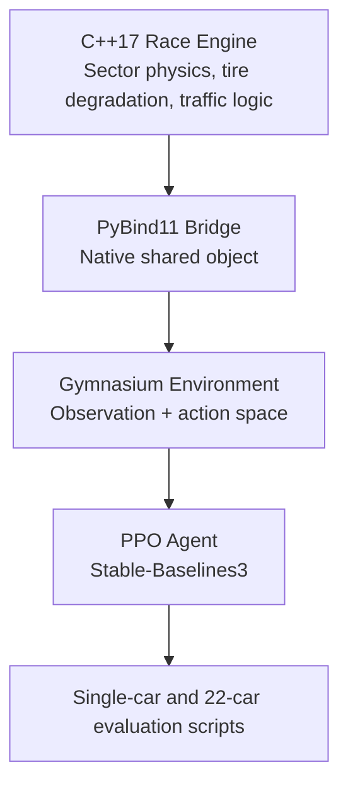

# F1 Multi-Agent AI Strategy Engine

This project is a hybrid race-strategy system that combines a high-frequency C++17 simulation backend with Python-based reinforcement learning and evaluation scripts. The goal was not just to simulate a race, but to build a multi-agent strategy engine that can reason about pit timing, tire wear, traffic effects, and race-wide interactions.

The repository now has a cleaner structure: reusable Python lives in a small package, while the exploratory and experimental scripts are preserved instead of deleted.

## What This Project Does

- Simulates Formula 1 style race strategy with sector-level physics instead of simple lap averages.
- Models tire degradation, fuel burn, dirty air, DRS, and slipstream effects in C++.
- Exposes the C++ engine to Python through PyBind11 for fast training and evaluation loops.
- Trains a PPO agent with Gymnasium and Stable-Baselines3.
- Runs single-car and 22-car multi-agent evaluations with independent decisions per car.
- Includes a dynamic programming baseline to compare learned strategy against a deterministic optimum.

## Folder Structure

```text
Race/
├── backend/src/cpp/        # C++ engine, simulator, bindings, and legacy experiment scripts
├── race/                   # Core reusable Python package
├── experiments/            # Evaluation and analysis scripts used by the wrappers
├── build/                  # CMake build output (generated)
├── plots/                  # Generated plots and visual outputs
├── RL.py                   # Thin wrapper for training
├── evaluate_all_ai.py      # Thin wrapper for 22-car evaluation
├── CMakeLists.txt          # CMake build configuration
├── requirements.txt        # Python dependencies
└── README.md               # Project overview and setup guide
```

### What Belongs Where

- `backend/src/cpp/` contains the core native engine code: `engine.cpp`, `simulator.cpp`, `bindings.cpp`, and related headers.
- `race/` contains reusable Python code such as the Gymnasium environment, training entry point, and launch helpers.
- `experiments/` contains reusable experiment scripts like multi-car evaluation and analysis routines.
- `backend/src/cpp/` still keeps the older exploratory scripts because you asked not to delete them yet.

## Architecture



### Phase 1: High-Fidelity C++ Physics Backend

The foundation of the project is a custom C++17 simulation engine. Instead of using simple lap-time averages, the race is broken into sector-level updates so the engine can track physical behavior with higher fidelity.

What was built:

- A state machine for continuous variables such as tire thermal degradation, fuel burn, and sector-by-sector deltas.
- Aerodynamic wake models that penalize cars in dirty air and reward cars that can use DRS or slipstream on straights.
- A 5D dynamic programming optimizer that computes a deterministic global baseline strategy for comparison.

### Phase 2: PyBind11 Zero-Latency Bridge

To avoid the performance cost of Python-only simulation or file-based communication, the C++ engine was exposed directly to Python through PyBind11.

What this gave you:

- A shared-object Python module that can be imported directly.
- Native access to core C++ structures such as `State`, `Action`, and `LapRecord`.
- A fast CPU-based simulation loop suitable for training and repeated evaluation.

### Phase 3: Gymnasium Environment and PPO Agent

The simulator was wrapped in a custom Gymnasium environment so it could be trained with reinforcement learning.

What was defined:

- Observation space: current lap, tire age, and gap to leader.
- Action space: pit or stay out, plus tire compound selection.
- PPO agent: Stable-Baselines3 was used to learn pit timing and compound choice.

### Phase 4: Reward Myopia and Fixes

The first training runs exposed a classic RL issue: the agent learned to avoid pitting because the immediate penalty was too large.

How it was fixed:

- Reward shaping was added to penalize driving on excessively old tires.
- A pit-stop bonus was introduced to encourage strategic behavior.
- The discount factor was raised to `0.999` so the agent would value long-term race time more heavily.

### Phase 5: 22-Car Multi-Agent Grid

The end goal was a realistic race, not just a one-car time trial.

What was done:

- The C++ simulator was adapted to accept a dictionary of actions for multiple cars in the same lap.
- 22 cars were simulated with independent decisions based on their positions, tire ages, and traffic.
- The learned behavior naturally showed undercuts, longer leader stints, and strategy spread across the grid.

### Phase 6: CMake Build System

The build was formalized with CMake so the project could be compiled consistently across environments.

What this solved:

- Cleanly locating the correct Python and PyBind11 dependencies.
- Building the C++ engine and Python extension from one configuration.
- Making the project more portable and easier to reproduce.

## Setup

```bash
python3 -m venv .venv
source .venv/bin/activate
pip install --upgrade pip
pip install -r requirements.txt

mkdir -p build
cd build
cmake ..
cmake --build . -j$(nproc)
```

## Run

Train the PPO agent:

```bash
python3 RL.py
```

Run the 22-car evaluation:

```bash
python3 evaluate_all_ai.py
```

You can also run the package entry points directly:

```bash
python3 -m race.train
python3 -m race.play
```
<!-- 
## What To Keep Out Of Git

These are generated or local-only files and should stay untracked:

- `build/`
- `__pycache__/`
- compiled `.so` files
- `*.zip` model checkpoints
- `*.png` plots and exported figures
- local editor settings such as `.vscode/` -->

## Important Notes

- The experimental scripts are intentionally still present in `backend/src/cpp/`.
- The root Python entry points are thin wrappers so older commands still work.
- The `race/` package is the clean reusable layer to build on going forward.
- If you want, the next step is a careful rename pass for typo files like `simulattion.py` and `visulaise.py`, but I have not changed those without your explicit approval.

